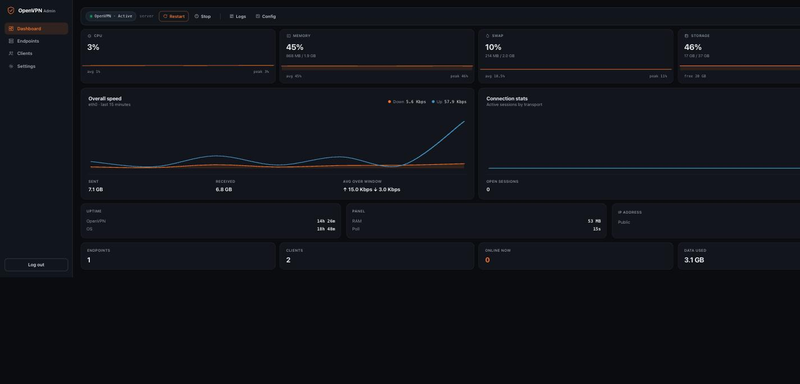

# ovpn-dashboard

A self-hosted admin panel for OpenVPN. FastAPI backend, no-build-step vanilla HTML/CSS/JS frontend, single binary-ish deploy (one systemd service, one Python venv). Built for people who want a real UI on top of OpenVPN — creating clients, setting limits, watching traffic — instead of hand-editing configs and juggling `easy-rsa` from memory.



**[Try the live demo →](https://codescaffold.github.io/openvpn-dashboard/demo/)** — the real frontend, running against fake (but realistic, live-updating) data. No install, no login, nothing to set up. Click around: create a client, hover the charts, poke through Settings.

## What it does

- **Endpoints** — independent OpenVPN listeners, each with its own port/protocol/cipher, each its own systemd unit. Run one on `1194/udp` for normal use and another on `443/tcp` so it's indistinguishable from ordinary HTTPS on a restrictive network. Every client can connect through any endpoint.
- **Clients** — issue/revoke/renew certificates, per-client max simultaneous connections, data quota, and bandwidth cap, enforced live via `tc` and OpenVPN's management interface. Certificate validity is a picker (1 month / 3 months / 1 year / ... / a specific date), not a raw day count.
- **Dashboard** — live CPU/RAM/swap/disk, a real interactive throughput chart (hover for a crosshair + exact values at that point in time), connection counts by transport, uptime, and a health banner when something's elevated.
- **Settings** — idle session timeout, login lockout tuning, sign out every other session, webhook/Telegram notifications (quota hit, connection-limit kill, endpoint down, manual restart), new-client defaults, one-click backup/restore, metrics retention window.
- **Backup & restore** — one button bundles the CA, every endpoint config, the client database and admin settings into a `.tar.gz`. Restore auto-snapshots the current state first, then restarts the panel cleanly.

## Architecture, in one paragraph

Each "endpoint" is a normal `openvpn-server@<name>` systemd instance with its own `server.conf`, subnet, and management port, all sharing one PKI (one CA, one CRL). The dashboard is a FastAPI app running as an unprivileged `ovpndash` user, talking to `easy-rsa` via subprocess for certs, to OpenVPN's management sockets for live sessions, and to `tc`/`ufw`/`systemctl` via a handful of tightly-scoped `sudo` grants for the handful of things that genuinely need root. There is no message queue, no separate frontend build, no Redis, no database server — SQLite and flat files, on purpose.

## Docker (fastest install)

The container runs systemd as PID 1 so it's the *exact same* app internally — `systemctl`, the sudoers grants, `journalctl` for the log viewer, all of it works unchanged, just inside the container instead of on bare metal. First boot generates the PKI, an OpenVPN endpoint, and an admin password automatically; nothing to configure by hand.

```bash
git clone https://github.com/CodeScaffold/openvpn-dashboard
cd openvpn-dashboard
sed -i 's/vpn.example.com/YOUR_SERVER_IP_OR_DOMAIN/' docker-compose.yml
docker compose up -d --build
docker compose logs | grep "Admin password"   # shown once, on first boot only
```

Then visit `http://YOUR_SERVER_IP_OR_DOMAIN:8080`.

That's it — OpenVPN and the dashboard are both running, on `1194/udp` and `8080/tcp` respectively, with a generated admin password waiting in the logs. Put a real reverse proxy + TLS in front of port 8080 for anything beyond testing (same nginx config as [step 10](#10-reverse-proxy--tls) below, just proxying to `127.0.0.1:8080` on the host — host networking means the container's port *is* the host's port, nothing container-specific needed).

**Why `--privileged` and host networking:** OpenVPN needs to configure real NAT/routing for tunneled traffic, which bridge networking can't do transparently — this is standard for any containerized VPN server, not specific to this app. `--privileged` (rather than a hand-picked capability list) is what lets systemd manage cgroups cleanly as PID 1; if you want a tighter capability set instead, `docker-compose.yml` is one file, start from `cap_add: [NET_ADMIN, NET_RAW, SYS_ADMIN]` and iterate.

**Configuration** — set as environment variables in `docker-compose.yml` (or `-e` flags on `docker run`):

| Variable | Required | Default | What it does |
|---|---|---|---|
| `VPN_ENDPOINT` | yes | — | The address baked into every client's `.ovpn` (your domain or the bare IP) |
| `ADMIN_PASSWORD` | no | random, printed to logs once | Initial admin password |
| `OPENVPN_PORT` | no | `1194` | Base endpoint's port |
| `OPENVPN_PROTO` | no | `udp` | Base endpoint's protocol |

Data (the PKI, client database, admin settings) lives in two named Docker volumes (`ovpn-config`, `dashboard-config`) — `docker compose down` is safe, `docker compose down -v` deletes everything.

Not interested in Docker? Everything below is the same install, done by hand, for people who'd rather own every step (or aren't on a systemd + cgroup v2 host Docker likes).

## Requirements

- A Linux box you have root on. This was built and tested on **Ubuntu 24.04**; it'll very likely work on 22.04 and other systemd distros with only path tweaks.
- A public IP. A domain name is optional but recommended (for a real TLS cert on the panel itself).
- Python 3.10+.

Everything below is copy-pasteable. Replace `vpn.example.com`, `panel.example.com`, and `YOUR_SERVER_IP` with your own.

---

## 1. Base packages

```bash
apt update
apt install -y openvpn easy-rsa nginx python3-venv python3-pip git ufw
```

## 2. Build the PKI

```bash
make-cadir /etc/openvpn/easy-rsa
cd /etc/openvpn/easy-rsa
```

Edit `vars` (create it if it doesn't exist) — this is the one place cert defaults live:

```bash
cat > vars <<'EOF'
set_var EASYRSA_ALGO ec
set_var EASYRSA_CURVE prime256v1
set_var EASYRSA_CA_EXPIRE 3650
set_var EASYRSA_CERT_EXPIRE 3650
set_var EASYRSA_BATCH 1
EOF
```

Now build it:

```bash
./easyrsa init-pki
./easyrsa build-ca nopass          # you'll be prompted for a CA Common Name — anything is fine
./easyrsa gen-req server nopass
./easyrsa sign-req server server   # type "yes" to confirm
openvpn --genkey secret pki/tls-crypt.key   # tls-crypt isn't an easy-rsa concept — it's OpenVPN's own static key
```

Copy the server identity files where OpenVPN expects them:

```bash
mkdir -p /etc/openvpn/server /etc/openvpn/ccd /etc/openvpn/clients
cp pki/ca.crt pki/issued/server.crt pki/private/server.key pki/tls-crypt.key /etc/openvpn/server/
./easyrsa gen-crl
cp pki/crl.pem /etc/openvpn/server/
chmod 600 /etc/openvpn/server/server.key
```

## 3. The base "server" endpoint

This becomes the endpoint the dashboard calls `server` — it's the one it discovers automatically on first boot; every endpoint you create afterward through the UI follows the exact same shape.

```bash
cat > /etc/openvpn/server/server.conf <<'EOF'
port 1194
proto udp
dev tun
ca ca.crt
cert server.crt
key server.key
tls-crypt tls-crypt.key
dh none
ecdh-curve prime256v1
topology subnet
server 10.9.0.0 255.255.255.0
ifconfig-pool-persist ipp.txt
push "redirect-gateway def1 bypass-dhcp"
push "dhcp-option DNS 1.1.1.1"
push "dhcp-option DNS 1.0.0.1"
keepalive 10 120
cipher AES-128-GCM
data-ciphers AES-128-GCM
auth SHA256
user nobody
group nogroup
persist-key
persist-tun
status /var/log/openvpn/status.log
verb 3
explicit-exit-notify 1
crl-verify crl.pem
management 127.0.0.1 7505
client-config-dir /etc/openvpn/ccd
duplicate-cn
max-clients 50
EOF
```

`dh none` + `ecdh-curve prime256v1` is deliberate — the CA is EC (`prime256v1` from `vars` above), so there's no Diffie-Hellman params file to generate or rotate. `management 127.0.0.1 7505` is what lets the dashboard read live session state and kill individual clients; keep it bound to loopback, never expose it.

## 4. Routing: IP forwarding, NAT, firewall

```bash
# persistent IP forwarding
echo 'net.ipv4.ip_forward=1' > /etc/sysctl.d/99-openvpn.conf
sysctl --system

# NAT: VPN clients need to masquerade as your real interface.
# Check your public interface name first (often eth0, sometimes ens3/enp1s0):
ip route get 1.1.1.1

# Add this line inside the existing *nat / :POSTROUTING block of /etc/ufw/before.rules
# (create the block if ufw hasn't added one yet — it goes above the "*filter" line):
```

```
*nat
:POSTROUTING ACCEPT [0:0]
-A POSTROUTING -s 10.9.0.0/24 -o eth0 -j MASQUERADE
COMMIT
```

Then allow forwarding between the tunnel and your public interface, and open the VPN port itself:

```bash
ufw route allow in on tun0 out on eth0
ufw route allow in on eth0 out on tun0
ufw allow 1194/udp comment 'OpenVPN'
ufw allow 22/tcp     # don't lock yourself out
ufw allow 80/tcp
ufw allow 443/tcp
ufw enable
```

Swap `eth0`/`tun0` for whatever `ip route` / `ip addr` actually show you — getting this interface name wrong is, by a wide margin, the most common reason "the VPN connects but no internet" happens.

## 5. Start the base endpoint

```bash
systemctl enable --now openvpn-server@server
systemctl status openvpn-server@server   # should say "active (running)"
```

If it doesn't come up, `journalctl -u openvpn-server@server -n 50 --no-pager` will tell you why — almost always a typo in `server.conf` or a missing file from step 2.

## 6. The dashboard's own system user

The dashboard runs as an unprivileged user with a narrow, explicit set of `sudo` grants — never as root.

```bash
useradd --system --home /opt/ovpn-dashboard --shell /usr/sbin/nologin ovpndash
usermod -aG systemd-journal ovpndash   # lets it read logs for the viewer, nothing else

chown -R ovpndash:ovpndash /etc/openvpn/easy-rsa /etc/openvpn/ccd /etc/openvpn/clients
chown ovpndash:ovpndash /etc/openvpn/server
```

Grant exactly these, and nothing more, via `visudo -f /etc/sudoers.d/ovpndash`:

```
ovpndash ALL=(root) NOPASSWD: /usr/bin/systemctl restart openvpn-server@server
ovpndash ALL=(root) NOPASSWD: /usr/bin/systemctl enable --now openvpn-server@*
ovpndash ALL=(root) NOPASSWD: /usr/bin/systemctl disable --now openvpn-server@*
ovpndash ALL=(root) NOPASSWD: /usr/bin/systemctl disable openvpn-server@*
ovpndash ALL=(root) NOPASSWD: /usr/sbin/ufw allow *
ovpndash ALL=(root) NOPASSWD: /usr/sbin/ufw delete allow *
```

That's the entire trusted-computing surface: it can start/stop OpenVPN endpoints it created and open/close firewall ports for them. It cannot restart itself, touch other services, or run arbitrary commands as root.

## 7. Get the code

```bash
git clone https://github.com/CodeScaffold/ovpn-dashboard /opt/ovpn-dashboard
cd /opt/ovpn-dashboard
python3 -m venv venv
venv/bin/pip install -r requirements.txt
chown -R ovpndash:ovpndash /opt/ovpn-dashboard
```

## 8. Secrets and config

The dashboard needs three things at boot: a session-cookie secret, an initial admin password (stored only as a salted hash — the plaintext is never written anywhere), and the address clients should connect to.

```bash
mkdir -p /etc/ovpn-dashboard
python3 - <<'EOF'
import hashlib, secrets

password = "CHANGE_ME_NOW"   # you'll change this from Settings → Account after first login anyway
salt = secrets.token_bytes(16)
digest = hashlib.pbkdf2_hmac("sha256", password.encode(), salt, 200_000)

print(f"SESSION_SECRET={secrets.token_hex(32)}")
print(f"ADMIN_PASSWORD_SALT={salt.hex()}")
print(f"ADMIN_PASSWORD_HASH={digest.hex()}")
EOF
```

Paste that output into `/etc/ovpn-dashboard/config.env`, and add your public endpoint:

```bash
cat >> /etc/ovpn-dashboard/config.env <<'EOF'
VPN_ENDPOINT=vpn.example.com
EOF

chmod 600 /etc/ovpn-dashboard/config.env
chown ovpndash:ovpndash /etc/ovpn-dashboard/config.env
```

`VPN_ENDPOINT` is whatever your clients will actually put in the "remote" line of their `.ovpn` file — your domain if you have one, otherwise the bare IP. It's required; the app won't start without it.

## 9. systemd service

```bash
cat > /etc/systemd/system/ovpn-dashboard.service <<'EOF'
[Unit]
Description=OpenVPN client-management dashboard
After=network.target

[Service]
User=ovpndash
Group=ovpndash
WorkingDirectory=/opt/ovpn-dashboard
EnvironmentFile=/etc/ovpn-dashboard/config.env
ExecStart=/opt/ovpn-dashboard/venv/bin/uvicorn app.main:app --host 127.0.0.1 --port 8080
Restart=on-failure
RestartSec=3
AmbientCapabilities=CAP_NET_ADMIN CAP_NET_RAW
PrivateTmp=true
ProtectSystem=strict
ReadWritePaths=/etc/openvpn/easy-rsa /etc/openvpn/clients /etc/openvpn/ccd /etc/openvpn/server /etc/ovpn-dashboard /etc/ufw /run

[Install]
WantedBy=multi-user.target
EOF

systemctl daemon-reload
systemctl enable --now ovpn-dashboard
systemctl status ovpn-dashboard   # should say "active (running)"
```

`AmbientCapabilities=CAP_NET_ADMIN CAP_NET_RAW` is what lets it run `tc` for bandwidth shaping without being root. **Do not** add `CapabilityBoundingSet=` to this unit — it's tempting, for defense-in-depth, to cap the bounding set to just those two capabilities, but the bounding set also caps what `sudo` can escalate *to*, and `ufw` internally needs more than that (it fails with `unable to change to root gid`). Ambient capabilities alone are the right amount of restriction here.

## 10. Reverse proxy + TLS

```bash
apt install -y certbot python3-certbot-nginx

cat > /etc/nginx/sites-available/panel.example.com.conf <<'EOF'
server {
    listen 80;
    server_name panel.example.com;
    location / { return 301 https://$host$request_uri; }
}

server {
    listen 443 ssl http2;
    server_name panel.example.com;

    location / {
        proxy_pass http://127.0.0.1:8080;
        proxy_http_version 1.1;
        proxy_set_header Host $host;
        proxy_set_header X-Real-IP $remote_addr;
        proxy_set_header X-Forwarded-For $proxy_add_x_forwarded_for;
        proxy_set_header X-Forwarded-Proto $scheme;
    }
}
EOF

ln -s /etc/nginx/sites-available/panel.example.com.conf /etc/nginx/sites-enabled/
nginx -t && systemctl reload nginx
certbot --nginx -d panel.example.com   # fills in ssl_certificate lines and reloads nginx for you
```

If you'd rather not run a public panel domain at all, skip this section and just SSH-tunnel to `127.0.0.1:8080` (`ssh -L 8080:127.0.0.1:8080 root@your-server`) — the dashboard never needs to be internet-facing for you to use it.

## 11. First login

Visit `https://panel.example.com` (or `http://127.0.0.1:8080` if you tunneled), sign in with the password you set in step 8, and immediately go to **Settings → Account** to change it to something you didn't type into a terminal.

From there:

1. **Clients → Create client** — pick a name, a connection cap, optionally a quota/bandwidth cap and a validity period. It signs the cert and offers the `.ovpn` file straight away.
2. Import that file into any OpenVPN client (Tunnelblick, OpenVPN Connect, NetworkManager, the official Android/iOS apps — anything that reads a standard `.ovpn`).
3. Optional: **Endpoints → Create endpoint** to add a second listener, e.g. `443/tcp` with the same or a different cipher, for networks that block anything that isn't port 443.
4. Optional: **Settings → Notifications** for a webhook or Telegram bot ping when a client hits its quota, gets killed for too many connections, or an endpoint goes down.
5. Optional: **Settings → Backup** — download a `.tar.gz` now and put it somewhere durable. It contains your CA private key; treat it like a root credential, not a config file.

## Updating

```bash
cd /opt/ovpn-dashboard
git pull
venv/bin/pip install -r requirements.txt   # only needed if requirements.txt changed
systemctl restart ovpn-dashboard
```

Nothing here touches `/etc/openvpn/*` — application updates and VPN operation are fully decoupled.

Docker: `git pull && docker compose up -d --build`. The named volumes mean your PKI, clients, and settings survive the rebuild untouched.

## Troubleshooting

**Client connects but has no internet.** Almost always the NAT masquerade rule in step 4 pointing at the wrong interface, or `net.ipv4.ip_forward` not actually being `1` (`sysctl net.ipv4.ip_forward` to check — the sysctl.d file only takes effect after `sysctl --system` or a reboot).

**`ufw: unable to change to root gid`** after adding the dashboard's sudoers rules. You added `CapabilityBoundingSet=` to the systemd unit. Remove it — see the note in step 9.

**`Failed to set up mount namespacing`, service won't start.** A path in `ReadWritePaths=` doesn't exist yet. Every directory listed there must exist *before* the service starts; `systemd` won't create them for you.

**A new endpoint's `client-config-dir` clients never get their static IP.** Endpoints created through the UI get their own `ccd` directory nested under `/etc/openvpn/ccd/<name>/` specifically because `ReadWritePaths=/etc/openvpn/ccd` only covers that path and its children — a sibling directory outside it would be read-only to the service no matter what you `chown`.

**Logs are empty in the dashboard's log viewer.** `ovpndash` needs to be in the `systemd-journal` group (step 6) — group membership from `usermod -aG` doesn't apply retroactively to a running process, so restart the `ovpn-dashboard` service (not just re-login) after adding it.

**Restore doesn't seem to finish.** It's supposed to look like that. On success the process deliberately exits non-zero so `systemd`'s `Restart=on-failure` brings up a clean process with fresh file handles — the dashboard reloads itself ~1.5 seconds after showing "Restore complete."

## Security notes

- Single shared admin password, no per-user accounts, by design — this is sized for "one person or a tiny trusted team," not a multi-tenant SaaS. If you need real RBAC, this isn't it.
- The backup file contains your CA private key. Anyone with it can mint valid client certificates. Store it encrypted, or at minimum somewhere with the same access control as your server's root password.
- The management interface (`127.0.0.1:7505` and friends) is unauthenticated by OpenVPN's own design — it's protected entirely by being bound to loopback. Never change that bind address.
- Put the panel behind a real TLS certificate (step 10) if it's reachable from the internet at all. Session cookies are `same_site=lax`, not `secure`-only, specifically so it still works over a plain HTTP LAN tunnel — don't run it over HTTP on the public internet.

## License

MIT — see [LICENSE](LICENSE).
